# Custom Cake Booking Class Diagram

This diagram illustrates the classes, interfaces, inheritance, composition, and dependency relationships for the `com.bakery.cake` module, including Admin Management, Role-Based Access, and Admin Price Overrides.

```mermaid
classDiagram
    %% Core Abstractions and Inheritance
    class CustomCake {
        <<abstract>>
        #BigDecimal BASE_PRICE_PER_KG
        #BigDecimal PRICE_PER_EXTRA_TIER
        -String flavour
        -double weightKg
        -int tiers
        -String messageOnCake
        -String specialInstructions
        +calculatePrice()* BigDecimal
        +getCakeType()* String
        +getExtraDetails() String
        +setFlavour(String flavour)
        +setWeightKg(double weightKg)
        +setTiers(int tiers)
        +setMessageOnCake(String message)
        +setSpecialInstructions(String notes)
        +getFlavour() String
        +getWeightKg() double
        +getTiers() int
        +getMessageOnCake() String
        +getSpecialInstructions() String
        #basePrice() BigDecimal
    }

    class BirthdayCake {
        -int age
        -int candles
        +calculatePrice() BigDecimal
        +getCakeType() String
        +getExtraDetails() String
        +setAge(int age)
        +setCandles(int candles)
        +getAge() int
        +getCandles() int
    }

    class WeddingCake {
        -boolean floralDecoration
        -String venueName
        +calculatePrice() BigDecimal
        +getCakeType() String
        +getExtraDetails() String
        +setVenueName(String venue)
        +setFloralDecoration(boolean floral)
        +isFloralDecoration() boolean
        +getVenueName() String
    }

    class AnniversaryCake {
        -int yearsOfAnniversary
        -String dedicationQuote
        +calculatePrice() BigDecimal
        +getCakeType() String
        +getExtraDetails() String
        +setYearsOfAnniversary(int years)
        +setDedicationQuote(String quote)
        +getYearsOfAnniversary() int
        +getDedicationQuote() String
    }

    class GeneralCustomCake {
        -String occasionDescription
        +calculatePrice() BigDecimal
        +getCakeType() String
        +getExtraDetails() String
        +setOccasionDescription(String desc)
        +getOccasionDescription() String
    }

    CustomCake <|-- BirthdayCake : Inheritance (IS-A)
    CustomCake <|-- WeddingCake : Inheritance (IS-A)
    CustomCake <|-- AnniversaryCake : Inheritance (IS-A)
    CustomCake <|-- GeneralCustomCake : Inheritance (IS-A)

    %% Composition & Booking Model
    class CakeBooking {
        -String bookingId
        -String customerId
        -CustomCake cake
        -LocalDate deliveryDate
        -String contactPhone
        -BookingStatus status
        -String imageFileName
        -LocalDateTime createdAt
        -BigDecimal customPrice
        +isPending() boolean
        +getPrice() BigDecimal
        +getCustomPrice() BigDecimal
        +setCustomPrice(BigDecimal price)
        +setCake(CustomCake cake)
        +setDeliveryDate(LocalDate date)
        +setContactPhone(String phone)
        +setStatus(BookingStatus status)
        +setImageFileName(String fileName)
        +getBookingId() String
        +getCustomerId() String
        +getCake() CustomCake
        +getDeliveryDate() LocalDate
        +getContactPhone() String
        +getStatus() BookingStatus
        +getImageFileName() String
        +getCreatedAt() LocalDateTime
    }

    class BookingStatus {
        <<enumeration>>
        PENDING
        CONFIRMED
        COMPLETED
        CANCELLED
        +getLabel() String
        +getBadgeClass() String
    }

    CakeBooking *-- CustomCake : Composition (HAS-A)
    CakeBooking o-- BookingStatus : Association

    %% Factory
    class CakeBookingFactory {
        +createFromForm(...) CustomCake
        +createFromFileLine(...) CustomCake
    }

    CakeBookingFactory ..> CustomCake : Creates
    CakeBookingFactory ..> BirthdayCake : Instantiates
    CakeBookingFactory ..> WeddingCake : Instantiates
    CakeBookingFactory ..> AnniversaryCake : Instantiates
    CakeBookingFactory ..> GeneralCustomCake : Instantiates

    %% Repository Abstraction & Implementation
    class BookingRepository {
        <<interface>>
        +findAll() List~CakeBooking~
        +findById(String id) Optional~CakeBooking~
        +findByCustomerId(String customerId) List~CakeBooking~
        +save(CakeBooking booking)
        +update(CakeBooking booking)
        +delete(String id)
        +generateNextId() String
    }

    class FileCakeBookingRepository {
        -TextFileStorage storage
        +findAll() List~CakeBooking~
        +findById(String id) Optional~CakeBooking~
        +findByCustomerId(String customerId) List~CakeBooking~
        +save(CakeBooking booking)
        +update(CakeBooking booking)
        +delete(String id)
        +generateNextId() String
        -serialise(CakeBooking b) String
        -deserialise(String line) CakeBooking
    }

    BookingRepository <|.. FileCakeBookingRepository : Implements (Abstraction)
    FileCakeBookingRepository ..> CakeBookingFactory : Uses to build models

    %% Customer & Role Provider Abstraction
    class CurrentCustomerProvider {
        <<interface>>
        +getCurrentCustomerId(HttpSession session) String
        +isAdmin() boolean
        +isAuthenticated() boolean
    }

    class SessionCurrentCustomerProvider {
        -getPrincipal() BakeryUserPrincipal
        +getCurrentCustomerId(HttpSession session) String
        +isAdmin() boolean
        +isAuthenticated() boolean
    }

    CurrentCustomerProvider <|.. SessionCurrentCustomerProvider : Implements

    %% Service Layer
    class CakeBookingService {
        -BookingRepository repository
        -CurrentCustomerProvider customerProvider
        -Path uploadDir
        +getMyBookings(HttpSession session) List~CakeBooking~
        +getBookingForCurrentCustomer(String id, HttpSession session) CakeBooking
        +createBooking(...) CakeBooking
        +updateBooking(...) void
        +cancelBooking(String id, HttpSession session) void
        +getAllBookings() List~CakeBooking~
        +getBookingByIdForAdmin(String id) CakeBooking
        +updateBookingStatus(String id, BookingStatus status) void
        +adminDeleteBooking(String id) void
        +adminUpdateBooking(...) CakeBooking
        +getUploadDir() Path
        -validateDeliveryDate(LocalDate date)
        -checkOwnership(CakeBooking booking, String customerId)
        -saveImage(MultipartFile file) String
        -deleteImageFile(String fileName)
    }

    CakeBookingService --> BookingRepository : Injected Dependency
    CakeBookingService --> CurrentCustomerProvider : Injected Dependency
    CakeBookingService ..> CakeBooking : Manages

    %% Controller Layer
    class CakeBookingController {
        -CakeBookingService bookingService
        -CurrentCustomerProvider customerProvider
        +listBookings(HttpSession, Model) String
        +showNewForm(Model) String
        +createBooking(...) String
        +viewBooking(String id, HttpSession, Model) String
        +showEditForm(String id, HttpSession, Model) String
        +updateBooking(...) String
        +cancelBooking(String id, HttpSession, RedirectAttributes, Model) String
        +adminListBookings(Model) String
        +adminViewBooking(String id, Model) String
        +adminUpdateStatus(String id, BookingStatus, RedirectAttributes) String
        +adminShowEditForm(String id, Model) String
        +adminSubmitEdit(...) String
        +adminDeleteBooking(String id, RedirectAttributes) String
        +adminShowNewForm(Model) String
        +adminCreateBooking(...) String
    }

    CakeBookingController --> CakeBookingService : Injected Dependency
    CakeBookingController --> CurrentCustomerProvider : Injected Dependency
```

